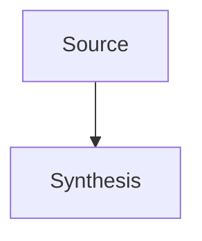

# Obsidian Patterns

## Frontmatter

Prefer YAML frontmatter for stable metadata. This is the default format for Obsidian Properties and Bases views:

```yaml
---
title: Example Note
aliases: [Alternate Name]
tags: [area/example, status/active]
created: 2026-05-26
updated: 2026-05-26
status: active
project: "[[Project Name]]"
area: Local model deployment
next: Observe long-running stability
---
```

Use ISO dates. Keep tags lowercase and slash-scoped when the vault already uses that style.

Avoid duplicating the same metadata as Dataview inline fields in the body. Use inline fields like `status:: active` only for notes that intentionally rely on Dataview inline queries or readable in-body metadata.

## Common Note Shapes

### Evergreen Concept

Use for durable ideas or technical knowledge:

```markdown
---
title: Concept Name
aliases: []
tags: [knowledge/concept]
created: YYYY-MM-DD
updated: YYYY-MM-DD
---

# Concept Name

One paragraph definition.

## Key Points

- Point with links to related notes.

## Examples

## Related

- [[Related Concept]]
```

### Project Note

Use for active work:

```markdown
---
title: Project Name
aliases: []
tags: [project, status/active]
created: YYYY-MM-DD
updated: YYYY-MM-DD
status: active
---

# Project Name

## Outcome

## Current State

## Decisions

## Tasks

- [ ] 

## Related
```

### Daily Note

Use the vault's existing daily-note folder and naming style when discoverable. Otherwise prefer `日记/YYYY-MM-DD.md`.

```markdown
---
title: YYYY-MM-DD
tags: [daily]
created: YYYY-MM-DD
---

# YYYY-MM-DD

## Log

## Tasks

## Notes Created

## Links
```

## Obsidian Features To Use

- Wiki links: `[[Note]]`, `[[Note|Alias]]`, `[[Note#Heading]]`.
- Embeds: `![[Attachment.png]]`, `![[Note#Section]]`.
- Blocks: add block IDs like `^decision-20260526` only when the user needs durable block links.
- Tags: use frontmatter for classification; inline tags for visible context.
- Dataview inline fields: `status:: active`, `owner:: [[Person]]`, `next:: Review`.
- Callouts:

```markdown
> [!note]
> Short contextual note.
```

Use callouts sparingly for warnings, decisions, examples, and summaries.

## Source-To-Wiki Ingestion

When ingesting a source, separate immutable input from maintained wiki synthesis:

1. Identify the source type, author/date if available, and why it matters.
2. Search for existing related pages by topic, entity, project, and aliases.
3. Create a source summary only when the source itself is worth finding later.
4. Update existing durable pages with the new facts, implications, and contradictions.
5. Add links both ways when practical: from the source summary to concepts, and from concepts back to the source.
6. Append a log entry with the source title and changed notes.

Useful source summary shape:

```markdown
---
title: Source Title
aliases: []
tags: [source]
created: YYYY-MM-DD
updated: YYYY-MM-DD
source_type: article
status: processed
---

# Source Title

## Summary

## Key Claims

## Implications

## Contradictions Or Tensions

## Updated Notes

- [[Related Concept]]
```

## Index And Log

Maintain an index for navigation and a log for chronology:

- `技术/00-System/index.md`: content-oriented catalog of important notes with links and one-line summaries.
- `技术/00-System/log.md`: append-only record of ingests, queries, lint passes, updates, and refactors.

Use parseable log headings:

```markdown
## [YYYY-MM-DD] ingest | Source Title

Changed: [[Note A]], [[Note B]]
Reason: One sentence.
```

Regenerate the index after broad structural changes. Append to the log after durable knowledge-base changes.

## Lint Checks

Periodically check for:

- Notes without YAML frontmatter.
- Notes without `## Related`, `## Links`, or `## 相关链接`.
- Orphan notes with no inbound wiki links.
- Duplicate title stems that may split a concept.
- Wiki links whose target file does not exist.
- Mentions of important concepts that do not have dedicated pages.
- Claims that contradict newer source notes.

## Search Patterns

Use these checks before large note operations:

```bash
rg --files "${OBSIDIAN_VAULT:-$HOME/workspace/notes}" -g "*.md"
rg "\[\[Note Name(\||#|\]\])" "${OBSIDIAN_VAULT:-$HOME/workspace/notes}"
rg "tags:|#tag-name|status::|project::" "${OBSIDIAN_VAULT:-$HOME/workspace/notes}"
```

## Obsidian Flavored Markdown Details

### Wikilinks

Use wikilinks for vault content because Obsidian can resolve and update them better than raw Markdown paths:

```markdown
[[Note Name]]
[[Note Name|Display Text]]
[[Note Name#Heading]]
[[Note Name#^block-id]]
[[#Heading in same note]]
```

Create block IDs only for content that needs stable fine-grained references:

```markdown
This decision should be linkable later. ^decision-20260606
```

For list items or callouts, put the block ID on a separate line after the block if inline placement would hurt readability.

### Embeds

Use embeds when the reader benefits from inline context:

```markdown
![[Note Name]]
![[Note Name#Heading]]
![[Attachment.png|300]]
![[document.pdf#page=3]]
![[Research Map.canvas]]
![[Project Dashboard.base#Active]]
```

Keep embed paths vault-relative. Prefer width-limited image embeds when a full-size image would dominate the note.

### Callouts

Use callouts sparingly:

```markdown
> [!summary]
> Short synthesis.

> [!warning] Risk
> Something that can invalidate the conclusion.

> [!todo]- Follow-up
> Collapsed by default.
```

Common callout types: `note`, `info`, `tip`, `summary`, `todo`, `question`, `warning`, `danger`, `success`, `failure`, `bug`, `example`, `quote`.

### Comments, Highlights, Math, Diagrams

```markdown
Visible text %%hidden note%%
==Highlighted phrase==
Inline math: $e^{i\pi} + 1 = 0$

$$
\frac{a}{b}=c
$$
```

Use Mermaid for diagrams when it is more maintainable than a Canvas:

````markdown

````

## Bases Patterns

Use Bases for property-driven dashboards and filtered views. A good Base has a narrow scope, clear property names, and at least one useful view.

Minimal table:

```yaml
filters:
  and:
    - 'file.ext == "md"'
    - 'status == "active"'

views:
  - type: table
    name: "Active"
    order:
      - file.name
      - status
      - updated
```

Task dashboard:

```yaml
filters:
  and:
    - file.hasTag("task")

formulas:
  days_until_due: 'if(due, (date(due) - today()).days, "")'
  is_overdue: 'if(due, date(due) < today() && status != "done", false)'

properties:
  formula.days_until_due:
    displayName: "Days Until Due"

views:
  - type: table
    name: "Open"
    filters:
      and:
        - 'status != "done"'
    order:
      - file.name
      - status
      - due
      - formula.days_until_due
```

Rules:

- Quote formulas and filters.
- Define every `formula.X` that appears in `order`, `properties`, or summaries.
- Date subtraction returns a duration; access `.days` before rounding.
- Guard optional fields with `if()`.
- Validate with `validate-base`.

## JSON Canvas Patterns

Use Canvas for spatial thinking: maps, workflows, dependency graphs, and research boards. Use Markdown notes for canonical knowledge; Canvas should link to or embed those notes rather than become the only source of truth.

Minimal canvas:

```json
{
  "nodes": [],
  "edges": []
}
```

Text node:

```json
{
  "id": "6f0ad84f44ce9c17",
  "type": "text",
  "x": 0,
  "y": 0,
  "width": 360,
  "height": 180,
  "text": "# Topic\n\nShort note."
}
```

File node:

```json
{
  "id": "a1b2c3d4e5f67890",
  "type": "file",
  "x": 460,
  "y": 0,
  "width": 360,
  "height": 240,
  "file": "AI/Example.md"
}
```

Edge:

```json
{
  "id": "0123456789abcdef",
  "fromNode": "6f0ad84f44ce9c17",
  "fromSide": "right",
  "toNode": "a1b2c3d4e5f67890",
  "toSide": "left",
  "toEnd": "arrow",
  "label": "expands into"
}
```

Validation checklist:

- IDs are unique 16-character lowercase hex strings.
- Edge endpoints reference existing node IDs.
- Text/file/link nodes contain `text`, `file`, or `url`.
- Coordinates and dimensions are integers.
- Color is `"1"` through `"6"` or a hex color.
- JSON parses and validates with `validate-canvas`.

## CLI And Web Extraction

Use the Obsidian CLI only when the running app state matters: active file, backlinks from the app, daily note integration, plugin reloads, DOM inspection, screenshots, or console errors. File edits should still favor deterministic vault-scoped operations.

Use Defuddle for web pages when installed:

```bash
defuddle parse "https://example.com/article" --md
defuddle parse "https://example.com/article" --md -o "source.md"
```

For source notes created from web pages, include:

```yaml
source_url: "https://example.com/article"
source_type: article
author:
published:
retrieved: YYYY-MM-DD
status: processed
```
